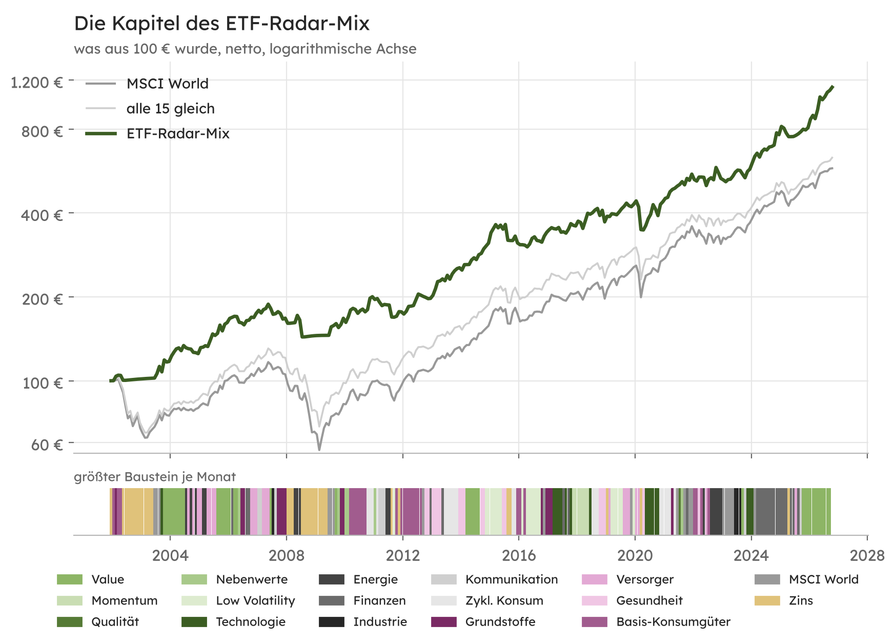

# Die Kapitel des ETF-Radar-Mix seit 2002

Rückblick auf MSCI-Indexbasis vom 31.12.2001 bis 30.10.2026. An jedem Monatsende bestimmt das Radar den Mix nur mit den Daten, die damals bekannt waren, und hält ihn einen Monat. Das ergibt 298 Monate. Phasen mit ähnlicher Zusammensetzung sind hier zu Kapiteln zusammengefasst, damit sich die 25 Jahre wie eine Geschichte lesen lassen.

> Keine Anlageberatung. Alle Zahlen beschreiben die Vergangenheit und sind eine Modellrechnung. Die Einstellungen wurden 2026 festgelegt, als der Zeitraum bekannt war. Der Rückblick ist deshalb eher zu gut als zu schlecht. Netto heißt nach ETF- und Handelskosten, vor Steuern.

Das Farbband zeigt je Monat den größten Baustein des Mix. Grau steht für den MSCI World, Gelb für Zins. Beides gilt, wenn keine Mischung die Prüfungen bestand oder die Trendregel gegriffen hat.

## Gesamtergebnis

Netto mit Kauf am Handelstag nach dem Monatsende, tatsächlichem EZB-Einlagesatz, laufenden Kosten der ETFs und 0,1% Handelskosten je Kauf und Verkauf:

| netto, 01/2002 bis 10/2026 | Wertentwicklung | im Jahr | größter Verlust |
|---|---|---|---|
| ETF-Radar-Mix | +1.031,2% | 10,3% | 23,7% |
| 3 beste mit Trend | +1.021,6% | 10,2% | 14,3% |
| MSCI World | +478,9% | 7,3% | 51,7% |
| alle 15 gleich | +532,1% | 7,7% | 47,6% |

Größter Verlust gemessen von Monatsende zu Monatsende. Jahr für Jahr stehen die Werte in der [Gegenrechnung](gegenrechnung.md#jahr-für-jahr), die Prüfung aller Zahlen im [Prüfbericht](pruefbericht.md).

## Kapitelregel

1. Je Monat zählt der größte Baustein des umgesetzten Mix. Ohne gültige Mischung oder nach der Trendregel ist das der MSCI World oder Zins.
2. Ein neues Kapitel beginnt, wenn dieser Baustein wechselt.
3. Kapitel unter 3 Monaten gehen im vorigen auf, benachbarte Kapitel mit gleichem Schwerpunkt werden verbunden.
4. „Wechselnd“ heißt, dass kein Baustein in mindestens der Hälfte der Monate vorn lag.

Die Regel ist eine Lesehilfe und kein Teil der Rechnung.

## Kapitel

„Typische Mischung“ nennt die drei Bausteine mit dem größten Anteil im Schnitt des Kapitels. Die Renditen gelten für das ganze Kapitel, netto.

| Gehalten | Monate | Schwerpunkt | Typische Mischung | Mix | 3 beste mit Trend | MSCI World | größter Verlust Mix |
|---|---|---|---|---|---|---|---|
| Jan 2002 bis Mai 2002 | 5 | Basis-Konsumgüter | Basis-Konsumgüter 57%, Grundstoffe 23%, Zins 20% · 1 Monat ohne gültige Mischung | +0,4% | −2,4% | −9,3% | 4,1% |
| Jun 2002 bis Jun 2003 | 13 | Zins | Zins 100% · 13 Monate ohne gültige Mischung | +1,8% | +2,0% | −24,6% | 0,0% |
| Jul 2003 bis Okt 2003 | 4 | MSCI World | MSCI World 75%, Technologie 25% · 3 Monate ohne gültige Mischung | +16,2% | +11,2% | +12,2% | 4,4% |
| Nov 2003 bis Apr 2005 | 18 | Value | Value 53%, Versorger 25%, Energie 21% | +11,7% | +17,1% | +6,4% | 6,5% |
| Mai 2005 bis Aug 2005 | 4 | Versorger | Versorger 100% | +11,5% | +17,4% | +11,0% | 1,2% |
| Sep 2005 bis Okt 2006 | 14 | Value | Value 50%, Grundstoffe 16%, Finanzen 14% | +14,3% | +13,6% | +16,9% | 6,8% |
| Nov 2006 bis Sep 2007 | 11 | Versorger | Versorger 56%, Kommunikation 27%, Industrie 10% | +4,7% | +12,9% | +5,8% | 8,0% |
| Okt 2007 bis Jan 2008 | 4 | Grundstoffe | Grundstoffe 100% | −9,2% | −4,0% | −13,0% | 9,2% |
| Feb 2008 bis Apr 2008 | 3 | Zins | Zins 100% · 1 Monat ohne gültige Mischung | +0,5% | +0,7% | −1,6% | 0,0% |
| Mai 2008 bis Jul 2008 | 3 | Energie | Energie 84%, Grundstoffe 16% | −11,1% | +0,8% | −10,9% | 16,3% |
| Aug 2008 bis Jun 2009 | 11 | Zins | Zins 100% · 11 Monate ohne gültige Mischung | +1,4% | +1,6% | −18,9% | 0,0% |
| Jul 2009 bis Mär 2010 | 9 | Wechselnd | MSCI World 33%, Nebenwerte 31%, Grundstoffe 15% · 3 Monate ohne gültige Mischung | +23,2% | +32,8% | +31,6% | 3,3% |
| Apr 2010 bis Okt 2010 | 7 | Basis-Konsumgüter | Basis-Konsumgüter 77%, Nebenwerte 10%, Zykl. Konsum 7% | +0,4% | −3,5% | −0,5% | 4,0% |
| Nov 2010 bis Mär 2011 | 5 | Zykl. Konsum | Zykl. Konsum 75%, Nebenwerte 20% | +6,4% | +9,8% | +8,4% | 4,4% |
| Apr 2011 bis Dez 2011 | 9 | Wechselnd | Kommunikation 28%, Zins 22%, Energie 18% · 1 Monat ohne gültige Mischung | −7,7% | −4,3% | −2,1% | 11,7% |
| Jan 2012 bis Jan 2013 | 13 | Basis-Konsumgüter | Basis-Konsumgüter 68%, Gesundheit 14%, MSCI World 8% · 1 Monat ohne gültige Mischung | +14,7% | +12,9% | +15,7% | 3,7% |
| Feb 2013 bis Jun 2013 | 5 | Gesundheit | Gesundheit 80%, Finanzen 20% | +12,7% | +10,7% | +8,3% | 1,5% |
| Jul 2013 bis Dez 2013 | 6 | Zykl. Konsum | Zykl. Konsum 92%, Value 8% | +11,3% | +9,4% | +9,6% | 3,2% |
| Jan 2014 bis Mär 2014 | 3 | Gesundheit | Gesundheit 74%, Zykl. Konsum 16%, Technologie 7% | +2,6% | +2,0% | +1,7% | 1,9% |
| Apr 2014 bis Nov 2014 | 8 | Value | Value 54%, Gesundheit 14%, Technologie 11% | +16,7% | +17,7% | +15,0% | 1,5% |
| Dez 2014 bis Dez 2016 | 25 | Low Volatility | Low Volatility 53%, Zykl. Konsum 10%, Basis-Konsumgüter 10% · 1 Monat ohne gültige Mischung | +11,8% | +7,9% | +24,4% | 16,9% |
| Jan 2017 bis Mär 2017 | 3 | Grundstoffe | Grundstoffe 74%, Technologie 19%, Energie 7% | +3,2% | +1,7% | +4,9% | 0,8% |
| Apr 2017 bis Nov 2017 | 8 | Technologie | Technologie 62%, Finanzen 31%, Grundstoffe 7% | +2,8% | +2,8% | +1,7% | 4,6% |
| Dez 2017 bis Jul 2018 | 8 | Momentum | Momentum 83%, Energie 10%, Technologie 7% | +11,0% | +3,8% | +6,8% | 5,9% |
| Aug 2018 bis Okt 2018 | 3 | Zykl. Konsum | Zykl. Konsum 51%, Technologie 23%, Energie 16% | −2,2% | −1,9% | −2,4% | 5,7% |
| Nov 2018 bis Mär 2019 | 5 | Gesundheit | Gesundheit 55%, Versorger 22%, Zins 20% · 1 Monat ohne gültige Mischung | +1,5% | −5,7% | +6,9% | 9,1% |
| Apr 2019 bis Aug 2019 | 5 | Low Volatility | Low Volatility 77%, Versorger 19% | +6,2% | +4,5% | +3,4% | 0,9% |
| Sep 2019 bis Mai 2020 | 9 | Versorger | Versorger 41%, MSCI World 11%, Zins 11% · 1 Monat ohne gültige Mischung | −14,6% | +0,7% | +0,9% | 21,4% |
| Jun 2020 bis Nov 2020 | 6 | Technologie | Technologie 100% | +19,0% | +4,3% | +12,3% | 8,6% |
| Dez 2020 bis Aug 2022 | 21 | Wechselnd | Zykl. Konsum 26%, MSCI World 19%, Basis-Konsumgüter 13% · 4 Monate ohne gültige Mischung | +24,6% | +42,7% | +24,0% | 9,0% |
| Sep 2022 bis Jan 2023 | 5 | Energie | Energie 83%, Basis-Konsumgüter 17% | −1,8% | −3,9% | −1,6% | 9,8% |
| Feb 2023 bis Jun 2023 | 5 | MSCI World | MSCI World 100% · 5 Monate ohne gültige Mischung | +6,6% | +0,6% | +6,8% | 1,5% |
| Jul 2023 bis Nov 2023 | 5 | Industrie | Industrie 37%, Technologie 31%, Value 20% | +0,6% | −2,7% | +3,5% | 6,1% |
| Dez 2023 bis Mär 2024 | 4 | Technologie | Technologie 53%, MSCI World 25%, Value 20% · 1 Monat ohne gültige Mischung | +16,3% | +16,8% | +14,0% | 0,0% |
| Apr 2024 bis Okt 2025 | 19 | Finanzen | Finanzen 61%, Kommunikation 13%, Momentum 10% | +21,9% | +23,7% | +21,9% | 8,1% |
| Nov 2025 bis Okt 2026 | 12 | Value | Value 78%, Energie 15% | +41,5% | +14,2% | +15,4% | 2,7% |

## Befunde

- **Vorsprung über 25 Jahre.** Der Mix kam netto auf 10,3% im Jahr, der MSCI World auf 7,3%, alle 15 gleich gewichtet auf 7,7%. Die einfache Regel „3 beste mit Trend“ kam auf 10,2%. Gesichert ist der Vorsprung nicht ([Prüfbericht](pruefbericht.md#was-nicht-signifikant-bedeutet)).
- **Kleinerer Verlust in Krisen.** Der größte Verlust lag beim Mix bei 23,7%, beim MSCI World bei 51,7%. 2002 brachte der Mix +1,5% gegen −32,2%, 2008 −13,5% gegen −37,8%. In 35 Monaten stand er im Zins, in 47 Monaten bestand keine Mischung.
- **Der Preis der Absicherung.** Nach Tiefpunkten kehrt die Regel spät zurück. 2009 brachte der Mix +15,5% gegen +25,7%, 2019 +15,7% gegen +29,8%. Auch 2015, 2021 und 2023 lag er deutlich zurück.
- **Wer den Mix trägt.** Im Schnitt aller Monate Zins 12%, Value 11%, Basis-Konsumgüter 8%, Versorger 8%, Technologie 8%, Zyklischer Konsum 7%. Qualität kam fast nie vor.
- **Wenige Bausteine.** In 102 Monaten bestand der Mix aus einem einzigen ETF, in 122 aus zwei und nur in 20 aus drei. Das erklärt die starken Ausschläge in beide Richtungen.
- **Wo der Vorsprung entstand.** In Abwärtsjahren wie 2002, 2008 und 2022 und in Jahren, in denen ein Sektor oder Faktor weit vorn lag, wie 2013, 2018, 2024 und 2026.

## Grundlage

- Tägliche Indexstände von MSCI (Net Total Return in Euro) für 15 globale Sektoren und Faktoren und den MSCI World ab 29.12.2000.
- Zins aus dem EZB-Einlagesatz ab 1999.
- Gerechnet mit dem Code des ETF-Radars mit den Standardeinstellungen (12 Monate Fenster, 95% Einfachheitsschwelle, 1.000 Stichproben, Trendregel mit 10 Monaten). Ausweichziel ist der MSCI World, solange er über seinem eigenen Durchschnitt liegt, sonst Zins. Diese Regel gilt seit November 2026, mit der alten Regel (fest MSCI World) wären es 48,9% größter Verlust gewesen.
- Die fünf Faktorindizes hat MSCI erst zwischen 2008 und 2014 gestartet und davor nachträglich berechnet ([Methodik, Abschnitt 11](methodik.md#11-rückblick)).
