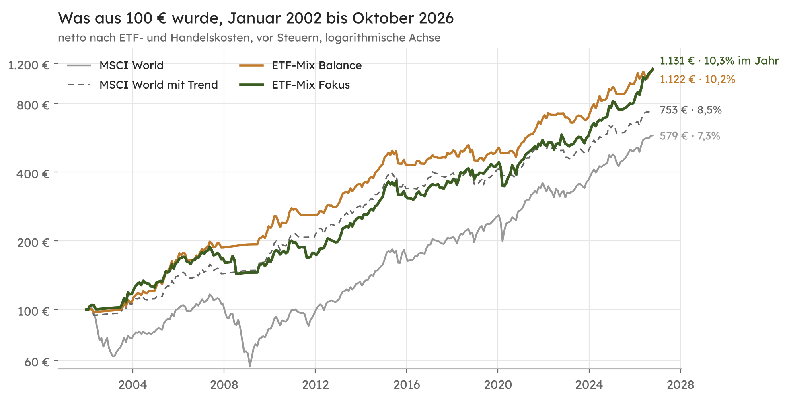
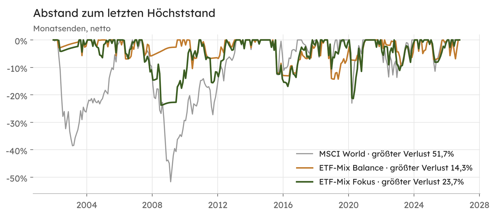
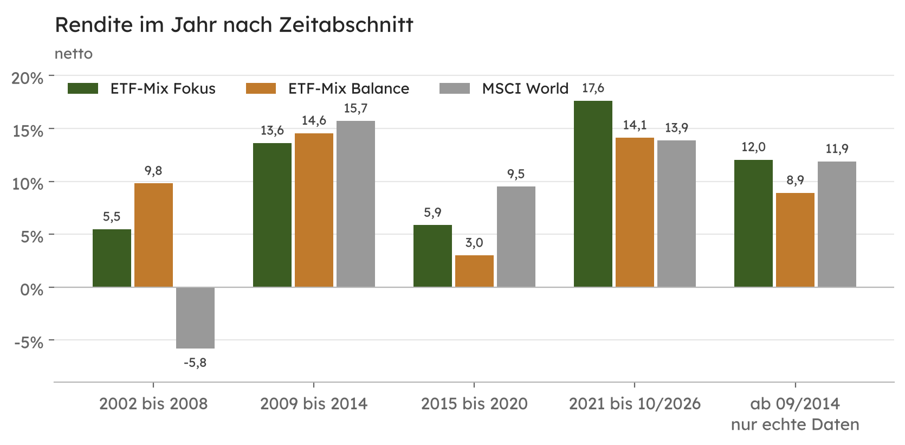
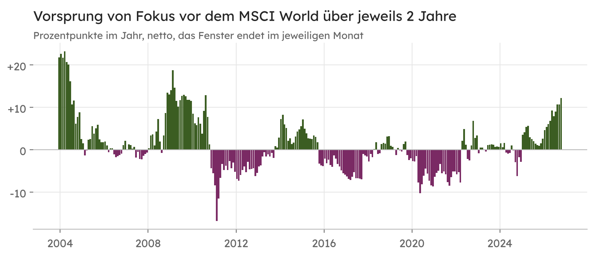
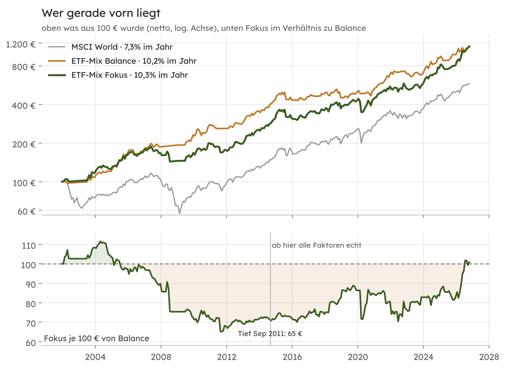
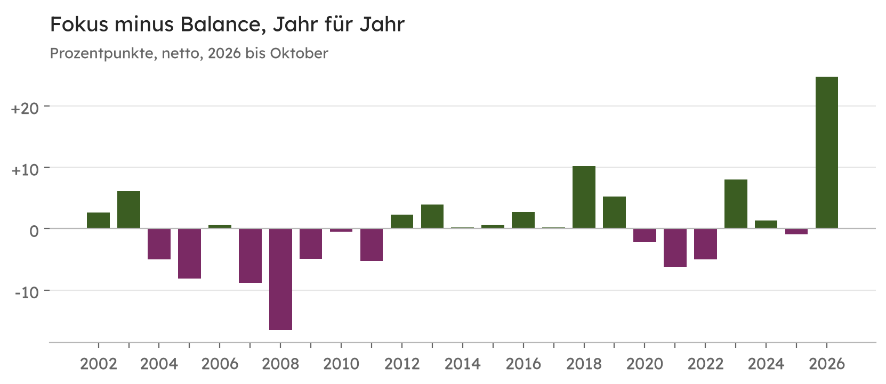

[Almanach](README.md) · [Methodik](methodik.md) · [Gegenrechnung](gegenrechnung.md) · [Kapitel](kapitel.md) · [Prüfbericht](pruefbericht.md) · [Wechsel und Kombi](varianten.md) · [Fragen](faq.md)

# Prüfbericht zum ETF-Radar

Stand 04.11.2026, Datenstand 30.10.2026.  
Namen auf den Stand vom 05.11.2026 gebracht, Zahlen unverändert.

Diese Seite prüft, ob die Zahlen des ETF-Radars stimmen, ob der Rückblick so gerechnet ist wie der laufende Betrieb und was die Ergebnisse aussagen und was nicht.

> Keine Anlageberatung. Alle Zahlen beschreiben die Vergangenheit und sind eine Modellrechnung. Vergangene Wertentwicklung ist kein verlässlicher Hinweis auf künftige Ergebnisse. Die Einstellungen wurden 2026 festgelegt, als der Zeitraum bekannt war. Der Rückblick ist deshalb eher zu gut als zu schlecht.

## Kurzfassung

| Frage | Ergebnis |
|---|---|
| Stimmt die Rechnung? | Ja. Mit frisch geladenen Daten trifft der Code in jedem der 298 Monate dieselbe Entscheidung wie im veröffentlichten Rückblick. Jede veröffentlichte Zahl ließ sich exakt nachrechnen. |
| Sind die Daten einheitlich? | Ja. Alles rechnet mit MSCI-Indexständen in Euro, für alle 15 Sektoren und Faktoren und den MSCI World. ETF-Kurse von ARIVA.DE springen nur ein, wenn MSCI am Monatsersten fehlt. Im Rückblick kamen sie nicht vor. |
| Gibt es eine Einschränkung bei den Daten? | Ja. Die fünf Faktorindizes hat MSCI erst zwischen 2008 und 2014 gestartet und davor nachträglich berechnet. In 38 von 298 Monaten steckte ein solcher Faktor in Fokus. |
| Rechnet der Rückblick wie der laufende Betrieb? | Ja. An jedem Monatsende läuft dieselbe Suche mit denselben Prüfungen und nur mit den Daten bis zu diesem Tag. Gekauft wird am Handelstag danach. |
| Schlägt Fokus den MSCI World? | Im Rückblick ja, netto um 2,9 Prozentpunkte im Jahr. Statistisch gesichert ist das nicht. |
| Ist die aufwendige Suche von Fokus besser als die einfache Regel von Balance? | Über 25 Jahre nein. Balance kam auf fast dieselbe Rendite, mit kleinerem größtem Verlust. Seit 2014 lag Fokus vorn. |
| Was ist gut belegt? | Der Schutz vor großen Verlusten. Alle Regeln mit Trendfilter verloren höchstens 14 bis 24%, der MSCI World 52%. |
| Was fehlt in den Zahlen? | Steuern. Im deutschen Privatdepot kosten sie bei monatlicher Umschichtung schätzungsweise 1,6 Prozentpunkte im Jahr. |

## Wie geprüft wurde

1. Die täglichen Indexstände aller 16 MSCI-Indizes (Net Total Return in Euro) ab 29.12.2000 und der EZB-Einlagesatz ab 1999 wurden am 04.11.2026 neu geladen.
2. Der Programmcode des ETF-Radars lief damit in einem Nachbau der Google-Umgebung über alle Monatsenden von Dezember 2001 bis September 2026. Das dauerte rund 10 Minuten.
3. Die Entscheidungen und die Bruttowerte Jahr für Jahr stimmten mit dem veröffentlichten Rückblick überein. Die Nettowerte ergaben dieselben Zahlen wie in [Gegenrechnung](gegenrechnung.md) und [Methodik](methodik.md#11-rückblick), etwa 10,26% im Jahr und +86,5% seit Januar 2024.
4. Balance und die Vergleichsregeln (MSCI World, MSCI World mit Trend, alle 15 gleich) wurden unabhängig davon ein zweites Mal aus den Indexständen gerechnet. Die Abweichung lag unter 0,01 Prozentpunkten je Monat und kommt aus der Tageszählung beim Zins.

### Wird zufällig gesucht?

Nein. Die Suche nach der Mischung prüft alle 32.767 Kombinationen der 15 Indizes systematisch. Zufall steckt nur im Zufallstest, der aus den echten Tagesrenditen 1.000 neue Jahre zusammensetzt. Sein Startwert hängt fest am Datum. Derselbe Tag liefert deshalb immer dasselbe Ergebnis, im laufenden Betrieb wie im Rückblick.

Nachgerechnet wird jedes Monatsende, nicht jeder Tag. Verbindlich ist nur die Mischung zum Monatsende, die täglichen Läufe im Monat sind Zwischenstände.

## 25 Jahre im Vergleich

| netto, 01/2002 bis 10/2026 | im Jahr | aus 100 € wurden | Schwankung im Jahr | größter Verlust | Rendite je Schwankung | Umschichtung im Jahr |
|---|---|---|---|---|---|---|
| **ETF-Mix Fokus** | **10,26%** | **1.131 €** | **12,5%** | **23,7%** | **0,78** | **461%** |
| ETF-Mix Balance | 10,22% | 1.122 € | 10,5% | 14,3% | 0,90 | 348% |
| MSCI World mit Trend | 8,47% | 753 € | 9,6% | 16,4% | 0,80 | 141% |
| MSCI World halten | 7,33% | 579 € | 14,1% | 51,7% | 0,51 | 0% |
| alle 15 gleich | 7,71% | 632 € | 13,1% | 47,6% | 0,56 | 11% |

Netto heißt nach laufenden Kosten der ETFs (0,19 bis 0,30% im Jahr), 0,1% Handelskosten je Kauf und Verkauf, Kauf am Handelstag nach dem Monatsende und mit dem tatsächlichen EZB-Einlagesatz für Monate im Geldmarkt. Rendite je Schwankung ist die Sharpe Ratio aus Monatswerten. „MSCI World mit Trend“ hält den MSCI World und wechselt in den Geldmarkt, wenn er unter dem Durchschnitt seiner letzten 10 Monatsenden liegt (Faber 2007). 461% Umschichtung heißen, dass im Schnitt jeden Monat rund 38% des Depots verkauft und neu gekauft werden.

## Woher der Vorsprung kommt

Der Vorsprung vor dem MSCI World entsteht fast ganz in den Baissen 2002/03 und 2008/09, in denen Fokus im Geldmarkt saß. In langen ruhigen Aufschwüngen lag der MSCI World vorn, 2015 bis 2020 sechs Jahre lang. Netto lag Fokus in 12 von 25 Kalenderjahren vor dem MSCI World.

## Was „nicht signifikant“ bedeutet

Eine Münze, die bei 20 Würfen 12 Mal Kopf zeigt, kann gezinkt sein oder einfach Glück gehabt haben. Erst nach sehr vielen Würfen weiß man es. Beim ETF-Radar ist es genauso. Der Abstand zum MSCI World schwankt von Monat zu Monat so stark, dass 2,9 Prozentpunkte im Jahr über 25 Jahre noch im Bereich des Zufalls liegen.

Gemessen wird das mit dem t-Wert nach Newey-West, der auch Zusammenhänge zwischen aufeinanderfolgenden Monaten berücksichtigt. Ab etwa 2 gilt ein Vorsprung als gesichert.

| Vergleich, netto, 01/2002 bis 10/2026 | Abstand im Jahr | t-Wert |
|---|---|---|
| Fokus gegen MSCI World | +2,9 Prozentpunkte | 1,17 |
| Fokus gegen MSCI World mit Trend | +1,8 Prozentpunkte | 1,34 |
| Fokus gegen Balance | +0,04 Prozentpunkte | 0,18 |
| Balance gegen MSCI World | +2,9 Prozentpunkte | 0,88 |

Bei gleichem Vorsprung bräuchte man rund 70 Jahre Daten statt 25, um einen t-Wert von 2 zu erreichen. Nicht signifikant heißt nicht, dass das Verfahren nicht funktioniert. Es heißt, dass die Daten es weder beweisen noch widerlegen.

Über 2 Jahre lag Fokus in 53% aller Zeitfenster vorn, über 3 Jahre in 48% und über 5 Jahre in 44%. Über 2 Jahre reichte der Abstand von 16,8 Prozentpunkten im Jahr zurück bis 23,2 Prozentpunkte vorn. Deshalb zeigt die LinkedIn-Folie einen festen Start im Januar 2024 statt eines rollierenden Fensters, und diese Seite nennt immer zusätzlich die 25 Jahre.

## Fokus gegen Balance

Der ETF-Mix Balance ist die einfachste Regel, die auf denselben Ideen beruht. An jedem Monatsende werden die 3 Sektoren und Faktoren mit der höchsten Rendite über 12 Monate zu gleichen Teilen gekauft. Liegt der MSCI World unter dem Durchschnitt seiner letzten 10 Monatsenden, gilt der Geldmarkt. Das ist Sektor-Momentum (Moskowitz und Grinblatt 1999) mit dem Trendfilter von Faber (2007). Seit November 2026 läuft Balance gleichrangig neben Fokus.

| netto, im Jahr und größter Verlust | ganzer Zeitraum 01/2002 bis 10/2026 | mit Rückrechnung 01/2002 bis 08/2014 | nur echte Daten 09/2014 bis 10/2026 |
|---|---|---|---|
| ETF-Mix Fokus | 10,3% · 23,7% | 8,6% · 23,7% | 12,0% · 21,4% |
| ETF-Mix Balance | 10,2% · 14,3% | 11,5% · 10,4% | 8,9% · 14,3% |
| MSCI World | 7,3% · 51,7% | 3,1% · 51,7% | 11,9% · 23,0% |

Größter Verlust innerhalb des jeweiligen Abschnitts. Beide Regeln landen nach 25 Jahren fast beim selben Endwert. Bis 2011 fiel Fokus auf rund 65% des Werts von Balance zurück, ab 2014 holte er auf und lag im Oktober 2026 wieder gleichauf. Die Monatsergebnisse beider Regeln hängen zu 0,73 zusammen.

### Drei Gründe für die Unterschiede

**1. Fokus setzt auf wenige Bausteine.** Die Suche nach der besten Rendite je Schwankung landet oft bei einem oder zwei ETFs. In 102 von 298 Monaten bestand Fokus aus einem einzigen ETF, in 122 aus zwei und nur in 20 aus drei. Dazu kamen 19 Monate MSCI World und 35 Monate Geldmarkt. Balance verteilt immer auf drei zu gleichen Teilen. Ein einzelner Sektor kann viel stärker steigen und fallen als drei zusammen. Daher kommt die höhere Schwankung von Fokus (12,5% gegen 10,5% im Jahr) und ebenso sein starkes Jahr 2026 mit Value und Energie.

**2. Der Ausstieg wird unterschiedlich ausgelöst.** Fokus prüft den Trend seiner eigenen Mischung. Solange die gewählten Sektoren steigen, bleibt er investiert, auch wenn der Gesamtmarkt schon fällt. Balance schaut nur auf den MSCI World. Daher kommen die größten Verluste von Fokus.

| Monat | Fokus hielt | Fokus | Balance hielt | Balance |
|---|---|---|---|---|
| Januar 2008 | Grundstoffe 100% | −4,2% | Geldmarkt | +0,3% |
| Juli 2008 | Energie 100% | −13,1% | Geldmarkt | +0,3% |
| März 2020 | Versorger 57%, Technologie 43% | −17,2% | Geldmarkt | −0,2% |

**3. Balance sitzt doppelt so oft im Geldmarkt.** Balance stand in 76 von 298 Monaten im Geldmarkt, Fokus in 35. Das schützt in Krisen, kostet aber im Aufschwung, weil der MSCI World nach einem Einbruch Monate braucht, bis er wieder über seinem Durchschnitt liegt. Im Mai und Juni 2020 brachte Fokus +3,8% und +5,8%, Balance lag im Geldmarkt.

### Was daraus folgt

Beide Regeln stehen auf denselben zwei Beinen, Sektoren mit starkem Lauf und ein Ausstieg bei fallendem Trend. Fokus ist die konzentriertere Fassung, Balance die breitere und vorsichtigere. Über 25 Jahre ergab das fast dieselbe Rendite, bei Fokus mit stärkeren Ausschlägen in beide Richtungen.

Warum es vor und nach 2014 so verschieden lief, lässt sich nicht sauber trennen. Möglich ist, dass die nachträglich berechneten Faktordaten vor 2014 Fokus benachteiligen. Genauso möglich ist, dass die Marktphasen verschieden waren, mit zwei großen Krisen bis 2009 und einem langen Aufschwung danach. Beide Regeln laufen deshalb seit November 2026 nebeneinander. Im November 2028 wird mit den Monaten entschieden, die bei der Wahl der Regeln noch nicht bekannt waren.

## Welche Daten drinstecken

| Quelle | wofür | laufend berechnet seit | im Rückblick ab 2001 |
|---|---|---|---|
| MSCI World und 10 Sektorindizes | Rechnung, Anzeige, Rückblick | vor 2001 | echte Werte |
| MSCI World Minimum Volatility (Low Volatility) | dasselbe | 14.04.2008 | davor nachträglich berechnet |
| MSCI World Momentum | dasselbe | 11.12.2013 | davor nachträglich berechnet |
| MSCI World Mid Cap Equal Weight (Nebenwerte) | dasselbe | 25.07.2014 | davor nachträglich berechnet |
| MSCI World Enhanced Value, Sector Neutral Quality | dasselbe | 11.08.2014 | davor nachträglich berechnet |
| EZB-Einlagesatz | Zins für Rendite je Schwankung und Verzinsung im Geldmarkt | 1999 | echte Werte |
| ARIVA.DE, Xetra-Kurse der ETFs | nur Ersatz, wenn MSCI fehlt | | nicht benutzt |

Alle Indizes sind Net Total Return in Euro, also mit wieder angelegten Dividenden nach Quellensteuer und vor ETF-Kosten. Ab dem 29.08.2014, als alle 15 Indizes laufend berechnet wurden, kam Fokus netto auf 12,0% im Jahr und der MSCI World auf 11,9%. Frühere Fassungen nannten 12,1%, der genaue Wert ist 12,05%.

## Wie sich die Zahlen verändert haben

Seit Oktober 2026 wurde die Rechnung in drei Schritten strenger. Jeder Schritt steht in der [Methodik](methodik.md).

| Stand | seit Januar 2024 | im Jahr ab 2002 | größter Verlust ab 2002 |
|---|---|---|---|
| bis 02.11.2026, brutto, Ausweichziel fest MSCI World | +105,1% | 10,5% | 48,9% |
| 03.11.2026, Ausweichziel Geldmarkt, wenn auch der MSCI World fällt | +93,9% | 11,9% | 23,6% |
| 04.11.2026, netto mit Kauf am Folgetag, Kosten und tatsächlichem Zins | +86,5% | 10,3% | 23,7% |
| Schätzung nach Steuern, siehe unten | | 8,6% | |

Seit Januar 2024 kamen der MSCI World netto auf +51,0%, Balance auf +53,3% und alle 15 gleich auf +49,1%. Diese 33 Monate waren eine außergewöhnlich gute Zeit für Fokus. Über 25 Jahre liegt er 2,9 Prozentpunkte im Jahr vor dem MSCI World, seit Januar 2024 sind es 9,2.

## Steuern

Monatliches Umschichten verkauft laufend mit Gewinn. Im deutschen Privatdepot fällt dabei Abgeltungsteuer an, und das Geld fehlt danach für den Zinseszins. Eine grobe Rechnung mit 26,375% Steuer (Abgeltungsteuer und Solidaritätszuschlag), 30% Teilfreistellung für Aktien-ETFs, Verrechnung von Verlusten und einem Verkauf von allem am Ende, damit auch der MSCI World seine Steuer zahlt:

| Schätzung, 01/2002 bis 10/2026 | vor Steuern | nach Steuern | Unterschied |
|---|---|---|---|
| ETF-Mix Fokus | 10,3% | 8,6% | −1,6 Prozentpunkte |
| ETF-Mix Balance | 10,1% | 8,6% | −1,6 Prozentpunkte |
| MSCI World halten | 7,3% | 6,6% | −0,7 Prozentpunkte |

Ohne Sparerpauschbetrag, Kirchensteuer und Vorabpauschale. Der Pauschbetrag hilft bei kleinen Depots spürbar, bei großen kaum. Nach dieser Schätzung bleiben vom Vorsprung vor dem MSCI World rund 2 Prozentpunkte im Jahr. Die übrigen Zahlen dieser Seite sind gemessen, diese ist geschätzt.

## Einordnung

- **Gut belegt** ist der Kern beider Regeln. Momentum bei Sektoren und ein Trendfilter auf Monatsbasis sind in der Forschung über Jahrzehnte und viele Märkte beschrieben. Im Rückblick haben beide Regeln die großen Einbrüche 2002 und 2008 weitgehend vermieden.
- **Offen** ist, ob die Suche nach der besten Rendite je Schwankung mehr bringt als die einfache Regel von Balance. Über 25 Jahre war sie nicht besser, seit 2014 schon. Das klärt erst die Zeit ab November 2026.
- **Realistisch** blieben im Rückblick nach Kosten und geschätzten Steuern rund 2 Prozentpunkte im Jahr vor dem MSCI World, bei deutlich kleinerem größtem Verlust. Dafür gab es Phasen von mehreren Jahren mit Rückstand, etwa 2015 bis 2020 mit 5,9% gegen 9,5% im Jahr.
- **Eine Trendregel wirkt nur, wenn man ihr folgt.** Wer nach einigen schwachen Jahren aussteigt, hat die Kosten getragen und den Schutz verpasst.

## Was noch kommt

- Im November 2028 wird mit 24 neuen Monaten zwischen Fokus und Balance entschieden.
- Die Kapitel der 25 Jahre stehen auf einer [eigenen Seite](kapitel.md).
- Ob man zwischen Fokus und Balance wechseln oder beide kombinieren sollte, prüft der [zweite Prüfbericht](varianten.md).

## Quellen

- Mebane T. Faber (2007), A Quantitative Approach to Tactical Asset Allocation, Journal of Wealth Management 9(4), S. 69–79.
- Tobias J. Moskowitz, Mark Grinblatt (1999), Do Industries Explain Momentum?, Journal of Finance 54(4), S. 1249–1290.
- Whitney K. Newey, Kenneth D. West (1987), A Simple, Positive Semi-Definite, Heteroskedasticity and Autocorrelation Consistent Covariance Matrix, Econometrica 55(3), S. 703–708.
- MSCI Inc., End-of-Day-Indexstände, Net Total Return in Euro, msci.com.
- Europäische Zentralbank, Zinssatz für die Einlagefazilität, EZB-Datenportal.
