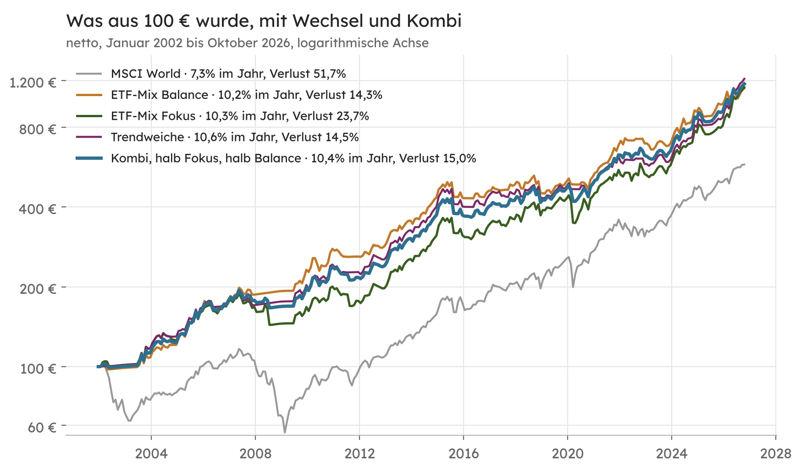
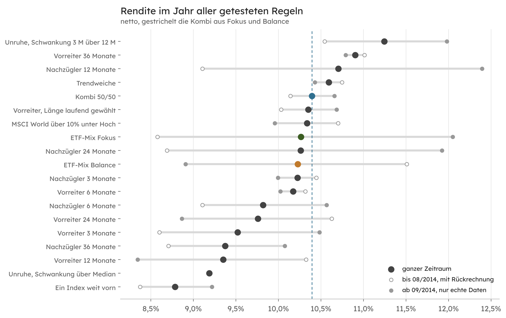
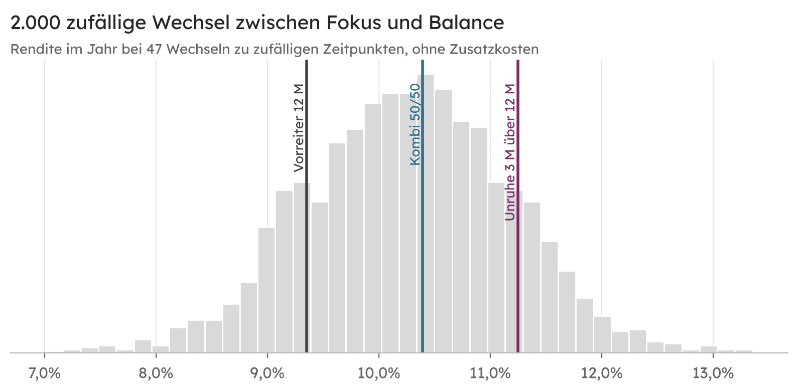
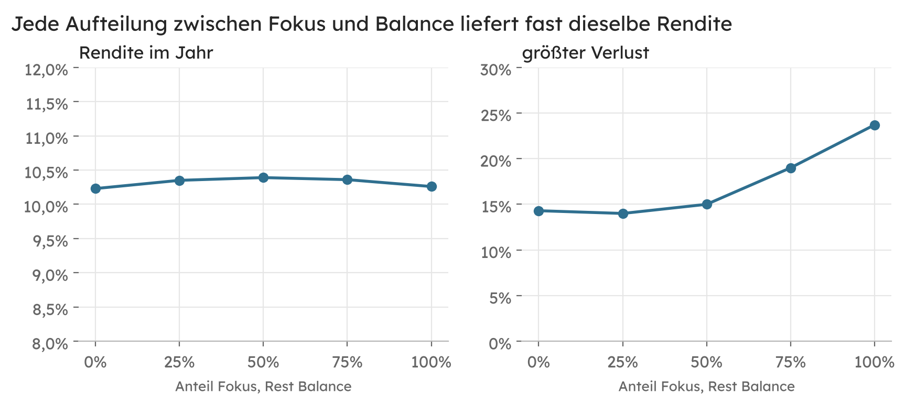

[Almanach](README.md) · [Methodik](methodik.md) · [Gegenrechnung](gegenrechnung.md) · [Kapitel](kapitel.md) · [Prüfbericht](pruefbericht.md) · [Wechsel und Kombi](varianten.md) · [Fragen](faq.md)

# Prüfbericht: Wechseln oder kombinieren?

Stand 04.11.2026, Datenstand 30.10.2026.  
Namen auf den Stand vom 05.11.2026 gebracht, Zahlen unverändert.

Der [erste Prüfbericht](pruefbericht.md) hat gezeigt, dass der ETF-Mix Fokus und der ETF-Mix Balance über 25 Jahre fast dieselbe Rendite brachten, aber in verschiedenen Phasen vorn lagen. Diese Seite prüft, ob sich das nutzen lässt. Lässt sich vorher erkennen, welche der beiden Regeln als Nächstes vorn liegt? Und wenn nicht, was ist die beste Art, beide zu verbinden?

> Keine Anlageberatung. Alle Zahlen beschreiben die Vergangenheit und sind eine Modellrechnung. Je mehr Regeln man an denselben Daten ausprobiert, desto eher sieht eine davon zufällig gut aus. Diese Seite nennt deshalb jede getestete Regel, auch die schlechten.

## Kurzfassung

| Frage | Ergebnis |
|---|---|
| Gibt es Börsenphasen, in denen eine der beiden Regeln verlässlich vorn liegt? | Nicht nachweisbar. In unruhigen Phasen lag Balance im Schnitt leicht vorn, aber der Unterschied ist so klein und so unregelmäßig, dass er Zufall sein kann. |
| Lohnt es, zu der Regel zu wechseln, die gerade vorn liegt? | Nein. Wer der Regel folgte, die in den letzten 12 Monaten vorn lag, kam auf 9,4% im Jahr und damit schlechter weg als mit Fokus oder Balance allein (10,3% und 10,2%). |
| Gibt es eine Wechselregel, die besser war? | Im Rückblick ja, die beste kam auf 11,3% im Jahr. Unter 16 getesteten Regeln ist ein solcher Wert aber auch ohne echten Vorteil zu erwarten. |
| Was hat zuverlässig funktioniert? | Beide Regeln zur Hälfte zu halten. Diese Kombi kam auf 10,4% im Jahr bei 15,0% größtem Verlust, vor und nach 2014 gleichmäßig, ohne eine einzige zusätzliche Annahme. |

## Die Ausgangslage

Fokus setzt meist auf ein oder zwei Sektoren, Balance verteilt immer auf drei. Bis 2011 lag Balance vorn, danach holte Fokus auf, 2020 bis 2022 lag wieder Balance vorn und 2026 Fokus. Die Monatsergebnisse beider Regeln hängen zu 0,73 zusammen. Sie sind eng verwandt, aber nicht gleich, und genau das macht eine Verbindung interessant.

## Gibt es Phasen?

Geprüft wurde, ob der Vorsprung von Fokus vor Balance von der Lage am Monatsende abhängt. Gezählt wird nur, was am Monatsende bekannt war.

| Lage am Monatsende | Monate | Fokus minus Balance, wenn ja | wenn nein | t-Wert |
|---|---|---|---|---|
| Schwankung des MSCI World in den letzten 3 Monaten höher als in den letzten 12 | 108 | −2,2 Prozentpunkte im Jahr | +1,7 | −0,99 |
| MSCI World unter seinem Durchschnitt der letzten 10 Monatsenden | 76 | −0,5 | +0,5 | −0,18 |
| MSCI World mehr als 10% unter seinem Höchststand | 119 | −0,1 | +0,5 | −0,18 |
| Bester Index über 12 Monate mehr als 15 Prozentpunkte vor dem drittbesten | 51 | +7,2 | −1,2 | 1,56 |
| Fokus lag in den letzten 12 Monaten vorn | 147 | −1,1 | +1,6 | −0,80 |

Die Richtung passt zur Vermutung. In unruhigen Monaten lag Balance eher vorn, und wenn ein einzelner Sektor davonlief, eher Fokus. Gesichert ist keiner dieser Unterschiede, alle t-Werte liegen unter 2.

Auch die Beharrung ist schwach. Ob Fokus in den nächsten 12 Monaten vorn liegt, hängt kaum davon ab, ob er in den letzten 12 vorn lag. Die Korrelation liegt bei −0,07 über alle Monate und bei +0,33 über 23 nicht überlappende Jahre, was bei so wenigen Jahren noch im Bereich des Zufalls liegt. Die Phasen in der Grafik sind im Nachhinein gut zu sehen, aber nicht im Voraus.

## Die getesteten Wechselregeln

Jede Regel wählt an jedem Monatsende zwischen den Anteilen von Fokus und denen von Balance. Gerechnet wird wie im Rückblick, mit Kauf am Handelstag nach dem Monatsende, laufenden Kosten der ETFs, 0,1% Handelskosten je Kauf und Verkauf auf jede Umschichtung, auch beim Wechsel zwischen den Regeln, und dem tatsächlichen EZB-Zins.

| Gruppe | Regel |
|---|---|
| Vorreiter | Die Regel, die in den letzten 3, 6, 12, 24 oder 36 Monaten vorn lag, gilt für den nächsten Monat. Dazu eine Fassung, die die Fensterlänge laufend nach dem bisherigen Ergebnis wählt. |
| Nachzügler | Genau umgekehrt, die Regel, die zurücklag, gilt. |
| Unruhe | Ist die Schwankung des MSCI World in den letzten 3 Monaten höher als in den letzten 12, gilt Balance, sonst Fokus. Zweite Fassung mit der Schwankung über dem Median aller bisherigen Monatsenden. |
| Abstand zum Hoch | Liegt der MSCI World mehr als 10% unter seinem Höchststand, gilt Balance. |
| Trendweiche | Liegt der MSCI World unter seinem Durchschnitt der letzten 10 Monatsenden, gilt Balance und damit der Geldmarkt, sonst Fokus. |
| Ein Index weit vorn | Ist der Abstand vom besten zum drittbesten Index höher als im bisherigen Median, gilt Fokus, sonst Balance. |
| Kombi | Kein Wechsel. Jeden Monat halb die Anteile von Fokus, halb die von Balance. |

| netto | im Jahr | bis 08/2014 | ab 09/2014 | größter Verlust | Rendite je Schwankung | t-Wert gegen Kombi |
|---|---|---|---|---|---|---|
| ETF-Mix Fokus | 10,3% | 8,6% | 12,0% | 23,7% | 0,78 | 0,12 |
| ETF-Mix Balance | 10,2% | 11,5% | 8,9% | 14,3% | 0,90 | −0,23 |
| **Kombi 50/50** | **10,4%** | **10,1%** | **10,7%** | **15,0%** | **0,90** | |
| Trendweiche | 10,6% | 10,8% | 10,4% | 14,5% | 0,93 | 0,21 |
| Unruhe, 3 Monate über 12 | 11,3% | 10,5% | 12,0% | 17,0% | 0,96 | 1,00 |
| Vorreiter 36 Monate | 10,9% | 11,0% | 10,8% | 21,4% | 0,87 | 0,74 |
| Nachzügler 12 Monate | 10,7% | 9,1% | 12,4% | 23,7% | 0,86 | 0,43 |
| Vorreiter, Länge laufend gewählt | 10,4% | 10,0% | 10,7% | 21,3% | 0,82 | 0,10 |
| Abstand zum Hoch | 10,3% | 10,7% | 10,0% | 21,4% | 0,82 | 0,09 |
| Vorreiter 12 Monate | 9,4% | 10,3% | 8,4% | 24,6% | 0,77 | −0,96 |
| Unruhe, über Median | 9,2% | 9,2% | 9,2% | 24,5% | 0,76 | −1,07 |
| Ein Index weit vorn | 8,8% | 8,4% | 9,2% | 21,6% | 0,69 | −2,33 |
| MSCI World | 7,3% | 3,1% | 11,9% | 51,7% | 0,51 | −1,09 |

Die übrigen Fensterlängen für Vorreiter und Nachzügler stehen in der Grafik, keine davon schneidet besser ab als die Kombi. Auffällig ist, wie stark sich ähnliche Regeln unterscheiden. „Vorreiter 12 Monate“ lag bei 9,4%, „Nachzügler 12 Monate“ bei 10,7%, „Vorreiter 36 Monate“ wieder bei 10,9%. Die Regel „Ein Index weit vorn“ verlor mit dem Median als Schwelle deutlich, obwohl die Tabelle zu den Phasen mit einer festen Schwelle von 15 Prozentpunkten einen Vorteil zeigt. So sieht ein Muster aus, das vom Zufall der Einstellung abhängt.

## Der Zufallsvergleich

Wer 47 Mal zu zufälligen Zeitpunkten zwischen den beiden Regeln wechselt, landet meist zwischen 8,8% und 11,7% im Jahr (5% bis 95% von 2.000 Läufen). „Vorreiter 12 Monate“ liegt mit ebenfalls 47 Wechseln im unteren Fünftel, „Unruhe“ mit 52 Wechseln im oberen Sechstel. Beide sind von zufälligen Wechseln nicht zu unterscheiden.

Härter ist die Prüfung nach White (2000), die berücksichtigt, dass 16 Wechselregeln ausprobiert wurden. Sie fragt, wie oft die beste von 16 Regeln die Kombi so deutlich schlägt, wenn in Wahrheit keine besser ist. Das Ergebnis ist 91% (Block-Bootstrap mit 12-Monats-Blöcken, 2.000 Ziehungen). Der Vorsprung der besten Regel ist also genau das, was man beim Durchprobieren erwarten würde.

## Warum die Kombi trägt

Die Kombi ist nur ein Ergebnis dieser Prüfung und wird nicht als eigener Mix angeboten. Sie wählt nicht, sondern hält Fokus und Balance zu gleichen Teilen. Weil beide nicht im Gleichschritt laufen, gleichen sich ihre schwachen Phasen teilweise aus. Die Rendite liegt zwischen beiden, der größte Verlust fast so niedrig wie bei Balance, und das Ergebnis ist vor und nach 2014 fast gleich (10,1% und 10,7%). Die Aufteilung ist dabei unkritisch. Ob 25, 50 oder 75% Fokus, die Rendite bleibt bei 10,4% im Jahr. Es gibt also keine Einstellung, die man an den Daten hätte ausrichten können.

| Kombi 50/50 | |
|---|---|
| Bausteine je Monat | meist 3 oder 4, in 35 Monaten Geldmarkt |
| Umschichtung im Jahr | 385% (Fokus 461%, Balance 348%) |
| bei 0,2% Handelskosten je Seite | 9,6% im Jahr (Fokus 9,3%, Balance 9,5%, Trendweiche 9,6%) |
| seit Januar 2024 | +69,7% (Fokus +86,5%, Balance +53,3%, MSCI World +51,0%) |
| Aufteilung am 30.09.2026 | Value 50%, Energie 33%, Technologie 17% |

## Die Trendweiche

Unter den Wechselregeln ist die Trendweiche die einzige mit einer klaren Begründung. Sie behebt die größte Schwäche von Fokus aus dem [ersten Prüfbericht](pruefbericht.md#drei-gründe-für-die-unterschiede). Fokus steigt erst aus, wenn seine eigenen Sektoren fallen, die Trendweiche schon, wenn der Gesamtmarkt fällt. Damit sank der größte Verlust von 23,7% auf 14,5%, die Rendite lag bei 10,6% im Jahr. Gegen die Kombi ist auch dieser Vorsprung nicht gesichert (t-Wert 0,21), und ab 2014 lag die Trendweiche mit 10,4% knapp hinter ihr.

## Grenzen

- Alle Regeln wurden mit Kenntnis dieser 25 Jahre gewählt, auch die Kombi als Idee.
- Bis August 2014 beruhen Teile der Faktordaten auf nachträglicher Berechnung durch MSCI. Deshalb steht jedes Ergebnis auch für die Zeit ab September 2014 getrennt da.
- Steuern fehlen. Die Kombi schichtet ähnlich viel um wie die beiden Regeln, die [Schätzung im ersten Prüfbericht](pruefbericht.md#steuern) gilt sinngemäß.
- 298 Monate enthalten nur wenige große Krisen. Jede Aussage über Phasen stützt sich auf eine Handvoll Ereignisse.

## Wie gerechnet wurde

Die Entscheidungen von Fokus und Balance stammen aus dem Lauf des Programmcodes vom 04.11.2026 ([erster Prüfbericht](pruefbericht.md#wie-geprüft-wurde)). Jede Wechselregel und die Kombi wurden aus diesen Anteilen neu gerechnet, mit denselben Kosten und mit Umschichtung beim Wechsel. Signale nutzen nur Indexstände bis zum jeweiligen Monatsende. Die t-Werte sind nach Newey-West mit 12 Monaten Verzögerung gerechnet.

## Quellen

- Halbert White (2000), A Reality Check for Data Snooping, Econometrica 68(5), S. 1097–1126.
- Mebane T. Faber (2007), A Quantitative Approach to Tactical Asset Allocation, Journal of Wealth Management 9(4), S. 69–79.
- Tobias J. Moskowitz, Mark Grinblatt (1999), Do Industries Explain Momentum?, Journal of Finance 54(4), S. 1249–1290.
- Whitney K. Newey, Kenneth D. West (1987), A Simple, Positive Semi-Definite, Heteroskedasticity and Autocorrelation Consistent Covariance Matrix, Econometrica 55(3), S. 703–708.
